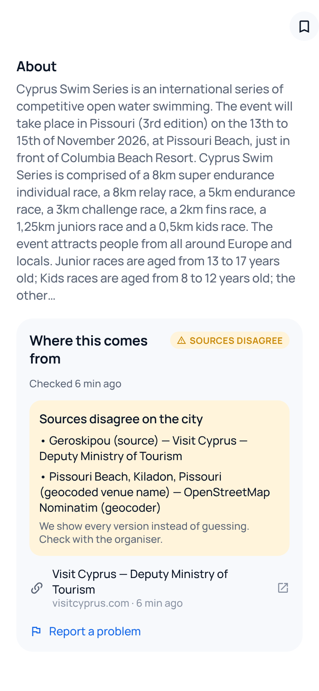
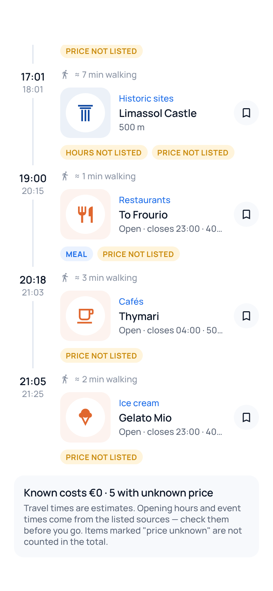

# passtra

**What's happening around you, right now.** Events, places and things to do nearby — from verified
sources, with the time each fact was last checked. Starting in Cyprus; built for international expansion.

<p>




</p>

## Monorepo

| Path | What |
|---|---|
| `packages/core` | Domain logic: taxonomy, regions, Europe/Nicosia time & DST, transliteration, price parsing, robots.txt, confidence & conflict resolution, dedup, recommendations, Plan My Day, multilingual query parser |
| `packages/brand` | passtra design tokens (colours, type, radius, motion) |
| `apps/api` | Fastify API + worker: PostGIS schema, Data Aggregation Engine (connectors, provenance, dedup, conflicts, adaptive scheduler), search/recs/plan, GDPR, admin endpoints |
| `apps/admin` | Moderation panel (served by the API at `/admin/`) |
| `apps/mobile` | Expo SDK 58 app (iOS/Android; web preview) |
| `brand/` | Logo sources and rendered app icons, splash, store graphic |
| `docs/` | Research, architecture, brand/UX, keys, strategy, testing, release |

## Quick start (local)

Requirements: Node 22, pnpm 10, PostgreSQL 15+ with PostGIS (or `docker compose -f infra/docker-compose.yml up db`).

```bash
pnpm install
cp apps/api/.env.example apps/api/.env      # set DATABASE_URL, AUTH_JWT_SECRET for dev
pnpm db:migrate                              # schema + countries/cities/categories + sources
pnpm --filter @passtra/api ingest visitcyprus_events   # live events (no key needed)
pnpm --filter @passtra/api ingest wikidata_cy           # museums & heritage (no key)
pnpm --filter @passtra/api ingest osm_cy                # places via Overpass (no key)
pnpm dev:api                                 # http://localhost:8080  (worker: pnpm dev:worker)
cd apps/mobile && cp .env.example .env && npx expo start
```

Tests: `pnpm test` (core unit tests + API integration tests on real Postgres/PostGIS), `pnpm typecheck`.
UI smoke test: `node scripts/e2e-web-smoke.mjs` against a served web build.

## Principles
- **Never invent facts.** Unknown times/prices are shown as unknown. AI only interprets queries; results always come from the database.
- **Provenance for every field.** Every value records its source and last-check time; disagreements are surfaced, never resolved by chance.
- **Legal data only.** Official APIs and open data; websites only via machine-readable feeds, honouring robots.txt and reviewed terms.
- **Privacy by default.** No account needed; location is never stored.

Documentation (Russian): [research](docs/01-research.md) · [architecture](docs/02-architecture.md) · [brand & UX](docs/03-brand-ux.md) · [API keys](docs/04-api-keys.md) · [strategy](docs/05-product-strategy.md) · [testing](docs/06-testing.md) · [release checklist](docs/release/release-checklist.md)

Data: © OpenStreetMap contributors (ODbL) · Wikidata (CC0) · Wikimedia Commons (per-file licences) · MET Norway (CC BY 4.0) · Deputy Ministry of Tourism, visitcyprus.com.
