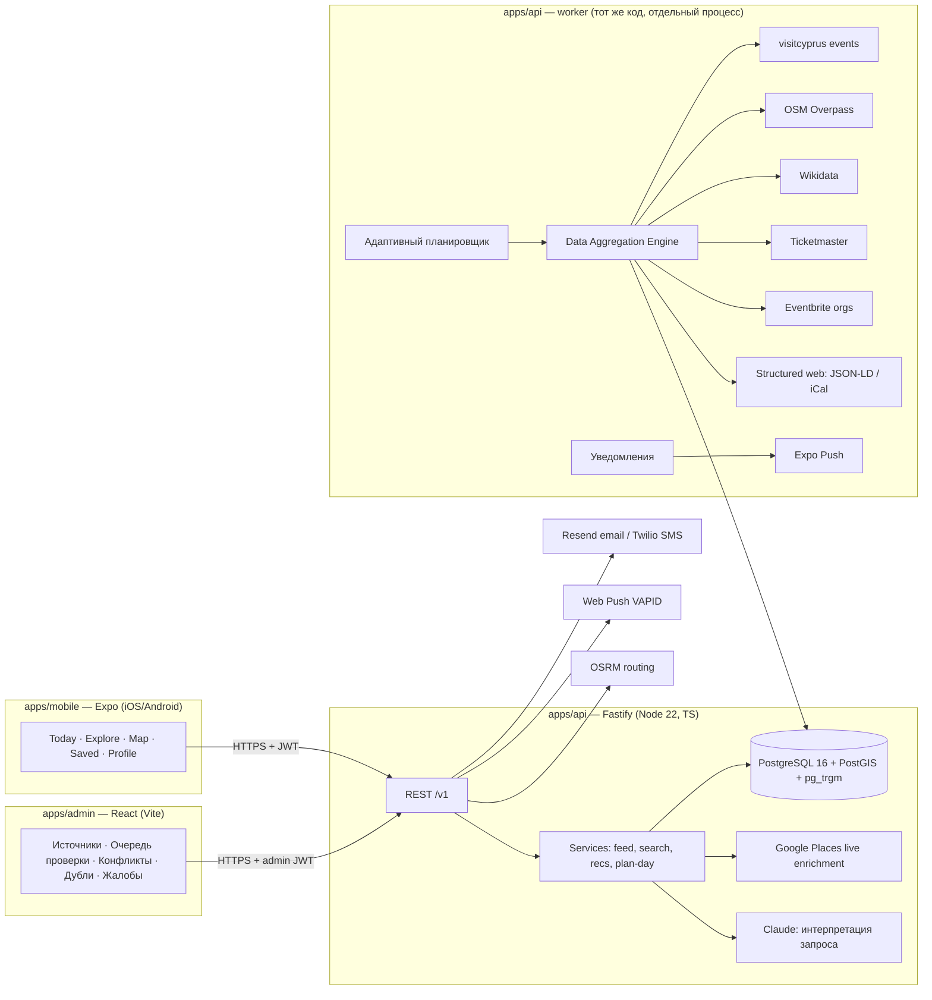
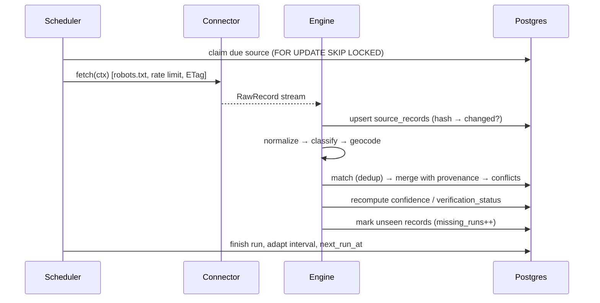

# Этап 2 — Архитектура passtra

## 1. Обзор



**Монорепозиторий (pnpm workspaces):**

| Пакет | Назначение |
|---|---|
| `packages/core` | Чистая доменная логика без I/O: таксономия категорий, время (Europe/Nicosia, DST), нормализация текста и транслитерация (el/ru → lat), дедупликация, оценка достоверности, ранжирование/рекомендации, планировщик дня, парсер запросов (en/el/ru), разбор цен, robots.txt. 100% покрыто unit-тестами. |
| `apps/api` | HTTP API + worker + миграции + коннекторы. Один образ, два процесса (`api`, `worker`). |
| `apps/admin` | Админ-панель (SPA, раздаётся статикой). |
| `apps/mobile` | Expo-приложение. |

**Почему так:**
- *Собственный Fastify-API поверх Postgres, а не прямой доступ клиента к Supabase.*
  Все ключи (Google, Anthropic, Ticketmaster) остаются на сервере; правила достоверности
  и выдачи — в одном месте; можно сменить хостинг БД без изменения клиента.
- *Собственные аккаунты в API* (email + пароль scrypt, JWT HS256 с идентификатором сессии в таблице
  `auth_sessions` — выход отзывает сессию на сервере). Email и телефон считаются привязанными только после
  ввода одноразового кода (хранится хэш, 10 минут, 5 попыток). Проверка внешних OIDC-токенов через JWKS
  оставлена для совместимости.
- *Напоминания «Моих событий»* — отдельный цикл каждые 30 с в фоновом процессе, независимо от загрузки
  источников: выбор `FOR UPDATE SKIP LOCKED`, доставка Web Push (VAPID) и Expo Push, статус
  `sent / failed / no_channel / skipped_stale` хранится в событии и показывается пользователю.
- *Очередь заданий на Postgres* (`sources.next_run_at` + `FOR UPDATE SKIP LOCKED`), а не Redis:
  меньше инфраструктуры; несколько worker'ов безопасно делят задания. Redis — опционально
  для распределённого rate limiting при горизонтальном масштабировании API.

## 2. Модель данных

Полная схема — `apps/api/migrations/*.sql`. Ключевые решения:

### 2.1 Международное расширение
`countries` (часовой пояс, валюта, локаль по умолчанию, флаг `enabled`) → `cities`
(центр, радиус, алиасы на всех языках, свой `timezone`). Ни одно правило не зашито
под Кипр: «сегодня», «вечер», «выходные» считаются в часовом поясе города/события.
Запуск новой страны = строки в `countries`/`cities` + источники в `sources`.

### 2.2 Единая модель сущностей
`places` и `events` — разные таблицы (разная семантика времени), но общий контракт:

| Общее поле | Смысл |
|---|---|
| `categories[]`, `primary_category` | Ссылки на единую таксономию (`packages/core/src/categories.ts`) |
| `location geography(Point)` + `location_precision` | `exact` / `approximate` (геокодинг) / `city` (только город) |
| `status` | Жизненный цикл (для событий: `scheduled/cancelled/postponed/rescheduled/unlisted/completed`) |
| `verification_status`, `confidence` 0–100 | Результат системы достоверности |
| `field_sources jsonb` | Для каждого поля: какой источник выбран и когда подтверждён |
| `last_verified_at` | Когда любой источник последний раз подтвердил запись |
| `external_ids jsonb` | `{"osm":"node/1","google":"ChIJ…","wikidata":"Q…","visitcyprus":"784995"}` |
| `is_demo` | Демо-данные (всегда помечаются бейджем DEMO в UI; в продакшене запрещены) |
| `merged_into` | Указатель после слияния дублей (старые ссылки не ломаются) |

### 2.3 Происхождение каждого факта
```
source_records      — сырой ответ источника (payload + hash), 1 строка на (source, external_id)
field_observations  — значение поля от конкретного источника: (entity, field, source) → value,
                      observed_at (впервые увидено), last_seen_at (последнее подтверждение)
data_conflicts      — поле, по которому источники расходятся: все кандидаты + статус
duplicate_candidates— пары-кандидаты на слияние для ручной проверки
```
Итоговое значение поля в `events/places` всегда выводится из `field_observations`
детерминированным правилом (см. 4.3) — никогда не «последний записавший побеждает».

### 2.4 Время
- Все моменты хранятся как `timestamptz` (UTC). Рядом — `timezone` события (IANA)
  и `local_start_date` (дата в поясе события) для событий «на весь день».
- `time_precision`: `exact` | `date_only`. Если источник не дал время — `date_only`,
  и UI пишет «Время не указано», а не «00:00».
- Локальное время без смещения (`2026-11-19 20:30:00` + `Asia/Nicosia`) переводится в UTC
  через Luxon с учётом DST; для несуществующего (весенний переход) и неоднозначного
  (осенний переход) времени поведение определено и покрыто тестами.
- `Asia/Nicosia` и `Europe/Nicosia` — синонимы в IANA; нормализуем к `Europe/Nicosia`.
  Северная часть острова — `Asia/Famagusta` (история правил отличается в 2016–2017).

### 2.5 Приватность в модели
- Координаты пользователя **не сохраняются** — приходят параметром запроса и забываются.
- `user_interactions` — только для персонализации, если она включена; хранятся 180 дней
  (job очистки); выключение персонализации удаляет историю.
- Кеш интерпретаций поиска хранит запрос **без** user id.
- `DELETE /v1/me` — каскадное удаление всех данных пользователя.

## 3. API (REST, `/v1`)

Публичные (без входа, rate limit по IP):

| Метод | Путь | Описание |
|---|---|---|
| GET | `/v1/meta` | Страны, города, категории, группы интересов, локали |
| GET | `/v1/feed/today` | Секции Today: happening_today, right_now, tonight, this_weekend, near_you, free, hidden_gems, popular |
| GET | `/v1/places` | Гео-поиск мест: `lat,lng,radius_km \| city`, `category`, `open_now`, `min_rating`, `price`, `q`, `sort` |
| GET | `/v1/places/:id` | Карточка + источники + (опц.) живое обогащение Google |
| GET | `/v1/events` | Предстоящие события: `from,to`, `free`, категории, радиус, город |
| GET | `/v1/events/:id` | Карточка: источники, время проверки, конфликты |
| GET | `/v1/map` | Объекты в `bbox` по слоям |
| POST | `/v1/search` | Умный поиск: `{q, lat, lng, city}` → `{interpretation, results}` |
| GET | `/v1/recommendations` | Персональная лента (интересы из профиля или параметром) |
| POST | `/v1/surprise` | 3–5 разнообразных вариантов |
| POST | `/v1/plan-day` | Маршрут дня |
| GET | `/v1/weather` | Погода (MET Norway, кеш по Expires) |
| POST | `/v1/reports` | Сообщить об ошибке/отмене |
| POST | `/v1/submissions/events` | Организатор добавляет событие (модерация) |

С входом (`Authorization: Bearer <JWT>`): `GET/PATCH/DELETE /v1/me`, `GET /v1/me/export`,
`/v1/me/saved`, `/v1/me/lists`, `/v1/me/interactions`, `/v1/me/push-tokens`, отзывы.

Админ (`role=admin|moderator`): `/v1/admin/stats`, `/sources` (+ запуск вручную),
`/runs`, `/errors`, `/review/events`, `/conflicts` (+resolve), `/duplicates` (+merge/dismiss),
`/reports`, `/submissions`, `/events/:id` (правка с аудитом), `/audit`.

Безопасность: helmet, CORS-allowlist, zod-валидация каждого входа, rate limit (глобальный +
жёсткий для `/search`, `/reports`, `/submissions`), лимит размера тела, параметризованный SQL,
аудит админ-действий, секреты только из env, `/v1/ready` проверяет БД.

## 4. Data Aggregation Engine



### 4.1 Коннектор
```ts
interface Connector {
  id: string;                   // 'tribe_events', 'osm_overpass', ...
  entityType: 'event' | 'place';
  fetch(ctx): AsyncIterable<RawRecord>;     // только чтение источника
  normalize(raw, ctx): NormalizedEvent | NormalizedPlace | null;
  fullSnapshot: boolean;        // true → отсутствие записи = сигнал «пропала»
}
```
Реализованы: `tribe_events` (The Events Calendar REST — visitcyprus.com и любые сайты на
этом плагине), `osm_overpass`, `wikidata_sparql`, `ticketmaster_discovery`,
`eventbrite_org`, `jsonld_events` (schema.org Event со страниц из allowlist),
`ical_feed`, `manual` (админ/организатор).

### 4.2 Нормализация
HTML-сущности → текст; обрезка описаний (короткая выдержка + ссылка на источник);
«весь день» 00:00–23:59:59 → `date_only`; цена из текста («FREE», «€20 – €70», «από €10»)
→ `is_free/min/max/currency`, при неуверенности — только `price_text`; детекция отмены
по статусу API и ключевым словам en/el/ru («cancelled», «ακυρώνεται», «отменено»…).

### 4.3 Дедупликация и слияние
- **События**: кандидаты из БД — та же локальная дата (±1 день), ≤ 2 км или тот же город,
  триграммное сходство названия. Оценка в `core/dedup.ts`: сходство названий
  (нормализация + транслитерация el/ru → lat, токены + триграммы), разница времени,
  расстояние, сходство площадки. ≥ 0.80 — автослияние, 0.60–0.80 — в очередь `duplicate_candidates`.
- **Места**: совпадение внешнего ID → то же место; иначе ≤ 75 м + сходство имени.
- **Выбор значения поля** (`core/confidence.ts → resolveField`):
  1. все источники согласны → значение, «подтверждено N источниками»;
  2. расходятся, и авторитетность лучшего источника выше следующего на ≥ 0.15 →
     значение лучшего, конфликт `auto_resolved` (виден в админке и в карточке:
     «другой источник указывает 21:00»);
  3. расходятся при близкой авторитетности → конфликт `open`, `verification_status = conflicting`,
     UI показывает оба варианта и «время не подтверждено». **Случайный выбор невозможен.**

### 4.4 Достоверность (0–100)
`score = 100 × (0.35·authority + 0.20·freshness + 0.10·official + 0.15·agreement + 0.20·organizer) − штраф за конфликты`
- *authority*: максимум по источникам (официальный организатор/площадка 1.0, госорган
  0.9, билетная платформа 0.85, агрегатор 0.75, редакционный 0.7, пользователь 0.3);
- *freshness*: экспоненциальный спад; период полураспада зависит от близости события
  (за 2 дня до концерта данные недельной давности «стареют» быстрее, чем за 2 месяца);
- *official*: есть официальная страница/билеты на домене организатора;
- *agreement*: число независимых источников, согласных по дате/времени/месту;
- *organizer*: событие подтверждено организатором (кабинет/верифицированная заявка).

`confirmed` ≥ 75 и (авторитетный источник или ≥ 2 согласных) · `likely` ≥ 50 ·
`unverified` · `conflicting` — при открытом конфликте по критичному полю.

### 4.5 Адаптивный планировщик
У каждого источника `min_interval_s … max_interval_s` (события: 15–30 мин, места: сутки–неделя).
После запуска: были изменения → интервал ÷ 2 (не ниже min); нет → × 1.5 (не выше max);
ошибка → экспоненциальный backoff, после 5 ошибок подряд — алерт в админке.
HTTP-кеш: ETag / If-Modified-Since, где источник поддерживает.

### 4.6 Пропавшие и прошедшие записи
- Запись не пришла в полном снимке → `missing_runs++`. Через 2 успешных запуска без записи
  у **всех** источников → `status = unlisted` (скрыто из выдачи, но **не** «отменено» —
  отменой помечаем только по явному сигналу источника, организатора или подтверждённой жалобе).
- Прошедшие события никогда не попадают в «предстоящие»: фильтр
  `coalesce(ends_at, starts_at + 3h) > now()` (для `date_only` — по локальной дате).
- Через 30 дней после окончания → `archived_at`; сырые payload'ы старше 90 дней очищаются.

## 5. Рекомендации и AI

- `core/ranking.ts`: интерпретируемая модель скоринга. Признаки: совпадение интересов
  (явных и неявных — аффинити категорий по взаимодействиям с затуханием 14 дней),
  расстояние (затухание), время (сегодня/сейчас/вечер, день недели, время суток ×
  тип категории), рейтинг (байесовское сглаживание), популярность, бюджет, возраст,
  штрафы за «скрыть»/«не интересно». Каждый вклад сохраняется как *причина* →
  объяснение «потому что вы интересуетесь музыкой · 4 км · сегодня в 20:00»
  строится из шаблона, без генерации фактов.
- Разнообразие: MMR-переранжирование по категориям (лента не из 10 баров подряд).
- Surprise Me: сэмплирование из топ-30 с температурой + обязательное разнообразие групп.
- Plan My Day (`core/plan-day.ts`): жадная сборка маршрута по слотам (завтрак/обед/ужин
  при попадании в окно), с проверкой часов работы и времени событий, длительностей
  визитов, времени в пути и бюджета. Неизвестная цена учитывается как «цена неизвестна»,
  а не 0.
- Умный поиск: Claude получает запрос и возвращает **только фильтры** (tool use со строгой
  схемой: категории из enum таксономии, временное окно, город, радиус, бесплатно, открыто
  сейчас, ключевые слова). Фильтры валидируются zod и выполняются в SQL. Без ключа или при
  ошибке/таймауте (2.5 с) — детерминированный парсер en/el/ru. Модель никогда не видит и
  не возвращает результаты.

## 6. Уведомления

Job раз в 30 мин: для пользователей с push-токеном и включёнными категориями ищет новые
события с `confirmed/likely`, в радиусе домашнего города, совпадающие с интересами.
Ограничения: тихие часы (по умолчанию 22:00–09:00 по поясу пользователя), максимум
N в день (по умолчанию 1) и в неделю, никогда не повторять одно событие (`notification_log`
unique), не уведомлять об `unverified`.

## 7. Мобильное приложение

Expo SDK 58 + expo-router, TypeScript. Навигация: вкладки Today · Explore · Map · Saved · Profile;
стек-экраны: детали места/события, поиск, Surprise Me, Plan My Day, онбординг, настройки
уведомлений/языка/приватности. Состояние данных — TanStack Query (кеш, офлайн-повтор,
stale-while-revalidate); избранное без входа — локально, со входом — синхронизация.
i18n: en/el/ru (i18next), новые языки — новый JSON. Тема: светлая/тёмная из токенов passtra.

## 8. Эксплуатация

- Docker-образ API/worker (`infra/Dockerfile`), `docker-compose` для локальной среды
  (Postgres+PostGIS).
- Логи — pino (JSON), request-id; ошибки — Sentry (опционально по DSN);
  `/v1/health` (жив), `/v1/ready` (БД доступна); метрики ingestion — в админке.
- CI: GitHub Actions — typecheck, unit-тесты core, интеграционные тесты API на Postgres+PostGIS.
